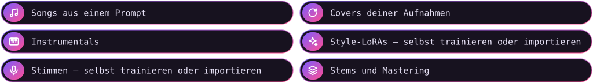

<p align="center">
  
</p>

<p align="center"><b>Ganze Songs mit bearbeitbarer Partitur, erzeugt mit YuE2 auf deiner eigenen GPU.</b></p>

<p align="center">
  <br>
  <a href="https://yeufonic.com/examples/"></a>
</p>

<p align="center">
  <a href="https://github.com/yeufonic/yeufonic/releases/latest"></a>
  <a href="https://yeufonic.com/macos/"></a>
  <a href="#schnellstart-mit-docker"></a>
  <a href="https://yeufonic.com"></a>
</p>

<p align="center">
  <a href="https://github.com/yeufonic/yeufonic/releases/latest"></a>
  <a href="https://github.com/yeufonic/yeufonic/releases"></a>
  <a href="https://github.com/yeufonic/yeufonic/stargazers"></a>
  <a href="https://github.com/yeufonic/yeufonic/commits/main"></a>
  <a href="LICENSE"></a>
</p>

<p align="center"><a href="README.md">English</a> · <b>Deutsch</b> · <a href="README.es.md">Español</a> · <a href="README.fr.md">Français</a> · <a href="README.it.md">Italiano</a> · <a href="README.nl.md">Nederlands</a> · <a href="README.pt.md">Português</a> · <a href="README.ru.md">Русский</a> · <a href="README.ja.md">日本語</a> · <a href="README.ko.md">한국어</a> · <a href="README.zh-CN.md">简体中文</a> · <a href="README.zh-TW.md">繁體中文</a></p>

---

> Diese Seite ist maschinell übersetzt und kürzer als das [englische README](README.md), das jedes Detail enthält. Die vollständige Anleitung gibt es auf Deutsch in der App (Hilfe) und hier: **[Anleitung auf Deutsch](app/static/guides/de-DE.md)**.

Eine Weboberfläche für [YuE2](https://github.com/multimodal-art-projection/YuE), das offene Musikmodell. Schreibe einen Song aus einem Prompt oder cover deine eigene Aufnahme. Trainiere eine lokale LoRA auf einer Sammlung von Musik. Bearbeite in beiden Fällen die Partitur und zieh danach die Stems aus dem Ergebnis.

## Was es kann

- **Song aus einem Prompt:** einen Partiturplan aus Stil und Songtext schreiben, bearbeiten und rendern.
- **Wähle deine Engine:** ComfyUI mit den YuE2-Nodes oder yue2.cpp (GGUF) für kleinere GPUs.
- **Eine Aufnahme covern:** deinen Song transkribieren, Melodie und Akkorde ändern und eine neue Version rendern.
- **Instrumentals:** die Struktur Abschnitt für Abschnitt aufbauen oder die Partitur einer Aufnahme spielen.
- **Eine Melodie aufnehmen:** singen, summen oder spielen und ein paar Takte zu einem ganzen Song erweitern.
- **MIDI-Import** für Covers und Instrumentals, mit Pianoroll und SF2-Klängen.
- **Style-LoRAs:** veröffentlichte nutzen oder mit der ComfyUI-Engine eigene aus einem Ordner voller Songs trainieren.
- **Aufgenommene Stimmen:** eine Stimme aus deinem Gesang trainieren und jeden Take darin singen lassen.
- **Songtexte und Duette:** Texte aus einem Satz entwerfen oder heraushören; Zeilen für einen Mann, eine Frau oder beide.
- **Vintage-Mastering-Rack und 3D Space:** EQ, Kompressor, Limiter in Echtzeit; Kopfhörer-Raumklang und 5.1.
- **Stems und DAW:** jeden Take in Spuren aufteilen oder als ZIP mit Audio, Stems, MIDI und Partitur speichern.
- **Eine Bibliothek:** Spaces, Sterne, Notizen und Take-Dateien, die einen Take samt Aufnahme teilen.
- **Bilder zu Songs** mit lokalen Modellen oder einem eigenen externen LLM, und ein **MCP-Server** für KI-Agenten.
- **Take-Panel und Editor:** das linke Panel zeigt, wie der gewählte Take entstand; ein großes Fenster, in drei Spalten oder als Schritte, ist der Ort, an dem Takes entstehen und sich ändern.
- **Fünfzehn Sprachen:** die App und ihre Anleitung, maschinell übersetzt.
- **Beispiel-LoRAs und -Songs**, mit Yeufonic gemacht: **[Beispiele](https://yeufonic.com/examples/)**.

Alles läuft auf einem Rechner, in zwei Teilen: der App und der Engine. Keine Cloud und keine Konten; ein externes LLM für Songtexte ist optional.

## Voraussetzungen

- Eine NVIDIA-GPU mit 12 GB VRAM oder mehr wird empfohlen, dazu 16 GB Arbeitsspeicher. Eine 8-GB-Karte ist einen Versuch wert; für kleinere Karten gibt es das INT8-Modell oder die Engine yue2.cpp.
- Eine LoRA lokal zu trainieren braucht praktisch 16 GB VRAM und 32 GB Arbeitsspeicher (mit dem INT8-Modell 8 GB VRAM).
- Etwa 30 GB freier Speicherplatz, mehr mit wachsender Bibliothek.
- Ein Mac mit Apple Silicon läuft experimentell und deutlich langsamer: siehe **[yeufonic.com/macos](https://yeufonic.com/macos/)**.

## Unter Windows, ohne Docker

Ein kleines Installationsprogramm richtet Yeufonic nativ ein, ohne Docker, ohne WSL und ohne Administratorrechte. Lade es aus der **[neuesten Version](https://github.com/yeufonic/yeufonic/releases/latest)** und starte es: Es prüft deinen Rechner, bevor es etwa 27 GB herunterlädt, größtenteils die Modelle. Ein neueres Installationsprogramm aktualisiert eine bestehende Installation. Windows 10 22H2 oder Windows 11 (64 Bit), NVIDIA-Karte ab RTX 30.

## Schnellstart mit Docker

Unter Linux oder Windows mit WSL2, mit Docker und dem NVIDIA Container Toolkit:

```sh
git clone https://github.com/yeufonic/yeufonic.git
cd yeufonic
sh scripts/fetch-models.sh          # etwa 19 GB, legt auch die Ordner an
docker compose up -d --build
```

Dann <http://localhost:8090> öffnen. Optionen (das kleinere Modell, yue2.cpp, Bildmodelle, Style-LoRAs) stehen im [englischen README](README.md#quick-start).

## Mehr

- **[Die vollständige Anleitung auf Deutsch](app/static/guides/de-DE.md)**, auch in der App unter Hilfe.
- **[Beispiel-Songs und LoRAs](https://yeufonic.com/examples/)**, mit Yeufonic gemacht.
- Fehler und Wünsche: [GitHub Issues](https://github.com/yeufonic/yeufonic/issues) (gern auf Englisch).

## Lizenz

Yeufonic steht unter einer Lizenz für den privaten, nicht kommerziellen Gebrauch: siehe [LICENSE](LICENSE). Modelle, LoRAs und andere Komponenten haben eigene Lizenzen; das [englische README](README.md#credits) nennt sie.
