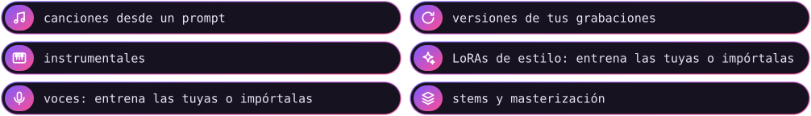

<p align="center">
  
</p>

<p align="center"><b>Canciones completas con una partitura editable, hechas con YuE2 en tu propia GPU.</b></p>

<p align="center">
  <br>
  <a href="https://yeufonic.com/examples/"></a>
</p>

<p align="center">
  <a href="https://github.com/yeufonic/yeufonic/releases/latest"></a>
  <a href="https://yeufonic.com/macos/"></a>
  <a href="#inicio-rápido-con-docker"></a>
  <a href="https://yeufonic.com"></a>
</p>

<p align="center">
  <a href="https://github.com/yeufonic/yeufonic/releases/latest"></a>
  <a href="https://github.com/yeufonic/yeufonic/releases"></a>
  <a href="https://github.com/yeufonic/yeufonic/stargazers"></a>
  <a href="https://github.com/yeufonic/yeufonic/commits/main"></a>
  <a href="LICENSE"></a>
</p>

<p align="center"><a href="README.md">English</a> · <a href="README.de.md">Deutsch</a> · <b>Español</b> · <a href="README.fr.md">Français</a> · <a href="README.it.md">Italiano</a> · <a href="README.nl.md">Nederlands</a> · <a href="README.pt.md">Português</a> · <a href="README.ru.md">Русский</a> · <a href="README.ja.md">日本語</a> · <a href="README.ko.md">한국어</a> · <a href="README.zh-CN.md">简体中文</a> · <a href="README.zh-TW.md">繁體中文</a></p>

---

> Esta página está traducida automáticamente y es más breve que el [README en inglés](README.md), que tiene todos los detalles. La guía completa está en español dentro de la aplicación (Ayuda) y aquí: **[guía en español](app/static/guides/es-ES.md)** ([Latinoamérica](app/static/guides/es-419.md)).

Una interfaz web para [YuE2](https://github.com/multimodal-art-projection/YuE), el modelo musical abierto. Escribe una canción a partir de un prompt o haz una versión de tu propia grabación. Entrena una LoRA local con una colección de música. En ambos casos edita la partitura y luego separa los stems del resultado.

## Qué hace

- **Canción desde un prompt:** escribe un plan de partitura a partir de un estilo y una letra, edítalo y renderízalo.
- **Elige tu motor:** ComfyUI con los nodos de YuE2, o yue2.cpp (GGUF) para GPU más pequeñas.
- **Versiona una grabación:** transcribe tu canción, cambia su melodía y sus acordes y renderiza una versión nueva.
- **Instrumentales:** construye la estructura sección a sección o toca la partitura de una grabación.
- **Graba una melodía:** cántala, tararéala o tócala y convierte unos compases en una canción entera.
- **Importación MIDI** para versiones e instrumentales, con piano roll y sonidos SF2.
- **LoRAs de estilo:** usa las publicadas o, con el motor ComfyUI, entrena las tuyas con una carpeta de canciones.
- **Voces grabadas:** entrena una voz con tu propio canto y haz que cualquier toma se cante con ella.
- **Letras y dúos:** redacta la letra desde una frase o sácala de una grabación; líneas para un hombre, una mujer o ambos.
- **Rack de masterización vintage y 3D Space:** ecualizador, compresor y limitador en tiempo real; sonido envolvente en auriculares y 5.1.
- **Stems y DAW:** separa cualquier toma en pistas o guárdala como un zip con audio, stems, MIDI y partitura.
- **Una biblioteca:** espacios, favoritos, notas y archivos de toma que comparten una toma con su grabación.
- **Imágenes para canciones** con modelos locales o tu propio LLM externo, y un **servidor MCP** para agentes de IA.
- **Un panel de toma y un editor:** el panel izquierdo muestra cómo se hizo la toma elegida, y una ventana grande, en tres columnas o por pasos, es donde se hacen y cambian las tomas.
- **Quince idiomas:** la aplicación y su guía, con traducción automática.
- **LoRAs y canciones de ejemplo** hechas con Yeufonic: **[ejemplos](https://yeufonic.com/examples/)**.

Todo funciona en un solo equipo, en dos partes: la aplicación y el motor. Sin nube y sin cuentas; un LLM externo para letras es opcional.

## Requisitos

- Se recomienda una GPU NVIDIA con 12 GB de VRAM o más, y 16 GB de RAM. Merece la pena probar una tarjeta de 8 GB; para tarjetas más pequeñas está el modelo INT8 o el motor yue2.cpp.
- Entrenar una LoRA en local necesita, en la práctica, 16 GB de VRAM y 32 GB de RAM (8 GB de VRAM con el modelo INT8).
- Unos 30 GB de disco libre, más a medida que crece la biblioteca.
- Un Mac con Apple silicon lo hace todo, también entrenar LoRAs, pero mucho más lento que una tarjeta NVIDIA: consulta **[yeufonic.com/macos](https://yeufonic.com/macos/)**.

## En Windows, sin Docker

Un pequeño instalador configura Yeufonic de forma nativa, sin Docker, sin WSL y sin permisos de administrador. Descárgalo de la **[última versión](https://github.com/yeufonic/yeufonic/releases/latest)** y ejecútalo: comprueba tu equipo antes de descargar unos 27 GB, casi todo los modelos. Un instalador más nuevo actualiza una instalación existente. Windows 10 22H2 o Windows 11 (64 bits) y una tarjeta NVIDIA RTX serie 30 o posterior.

## Inicio rápido con Docker

En Linux, o en Windows con WSL2, con Docker y el NVIDIA Container Toolkit:

```sh
git clone https://github.com/yeufonic/yeufonic.git
cd yeufonic
sh scripts/fetch-models.sh          # unos 19 GB, y crea las carpetas
docker compose up -d --build
```

Luego abre <http://localhost:8090>. Las opciones (el modelo pequeño, yue2.cpp, modelos de imagen, LoRAs de estilo) están en el [README en inglés](README.md#quick-start).

## Más

- **[La guía completa en español](app/static/guides/es-ES.md)**, también en la aplicación, en Ayuda.
- **[Canciones y LoRAs de ejemplo](https://yeufonic.com/examples/)**, hechas con Yeufonic.
- Errores y sugerencias: [GitHub Issues](https://github.com/yeufonic/yeufonic/issues) (mejor en inglés).

## Licencia

Yeufonic tiene una licencia para uso personal y no comercial: consulta [LICENSE](LICENSE). Los modelos, las LoRAs y otros componentes tienen sus propias licencias; el [README en inglés](README.md#credits) las enumera.
