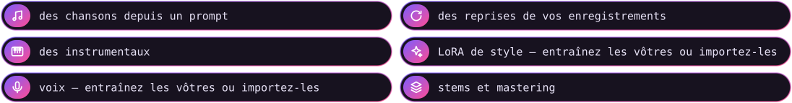

<p align="center">
  
</p>

<p align="center"><b>Des chansons entières avec une partition modifiable, faites avec YuE2 sur votre propre GPU.</b></p>

<p align="center">
  <br>
  <a href="https://yeufonic.com/examples/"></a>
</p>

<p align="center">
  <a href="https://github.com/yeufonic/yeufonic/releases/latest"></a>
  <a href="https://yeufonic.com/macos/"></a>
  <a href="#démarrage-rapide-avec-docker"></a>
  <a href="https://yeufonic.com"></a>
</p>

<p align="center">
  <a href="https://github.com/yeufonic/yeufonic/releases/latest"></a>
  <a href="https://github.com/yeufonic/yeufonic/releases"></a>
  <a href="https://github.com/yeufonic/yeufonic/stargazers"></a>
  <a href="https://github.com/yeufonic/yeufonic/commits/main"></a>
  <a href="LICENSE"></a>
</p>

<p align="center"><a href="README.md">English</a> · <a href="README.de.md">Deutsch</a> · <a href="README.es.md">Español</a> · <b>Français</b> · <a href="README.it.md">Italiano</a> · <a href="README.nl.md">Nederlands</a> · <a href="README.pt.md">Português</a> · <a href="README.ru.md">Русский</a> · <a href="README.ja.md">日本語</a> · <a href="README.ko.md">한국어</a> · <a href="README.zh-CN.md">简体中文</a> · <a href="README.zh-TW.md">繁體中文</a></p>

---

> Cette page est traduite automatiquement et plus courte que le [README en anglais](README.md), qui donne tous les détails. Le guide complet existe en français dans l’application (Aide) et ici : **[guide en français](app/static/guides/fr-FR.md)**.

Une interface web pour [YuE2](https://github.com/multimodal-art-projection/YuE), le modèle musical ouvert. Écrivez une chanson à partir d’un prompt, ou faites une reprise de votre propre enregistrement. Entraînez une LoRA locale sur un ensemble de morceaux. Dans les deux cas, modifiez la partition, puis séparez les stems du résultat.

## Ce qu’il fait

- **Une chanson depuis un prompt :** écrivez un plan de partition à partir d’un style et de paroles, modifiez-le, rendez-le.
- **Choisissez votre moteur :** ComfyUI avec les nœuds YuE2, ou yue2.cpp (GGUF) pour les petits GPU.
- **Reprenez un enregistrement :** transcrivez votre chanson, changez sa mélodie et ses accords, rendez une nouvelle version.
- **Instrumentaux :** construisez la structure section par section, ou jouez la partition d’un enregistrement.
- **Enregistrez un air :** chantez-le, fredonnez-le ou jouez-le, et faites de quelques mesures une chanson entière.
- **Import MIDI** pour les reprises et les instrumentaux, avec piano roll et sons SF2.
- **LoRA de style :** utilisez celles qui sont publiées ou, avec le moteur ComfyUI, entraînez les vôtres sur un dossier de morceaux.
- **Voix enregistrées :** entraînez une voix sur votre propre chant et faites chanter n’importe quelle prise avec elle.
- **Paroles et duos :** rédigez des paroles depuis une phrase ou relevez-les d’un enregistrement ; des lignes pour un homme, une femme ou les deux.
- **Rack de mastering vintage et 3D Space :** égaliseur, compresseur et limiteur en temps réel ; spatialisation au casque et 5.1.
- **Stems et DAW :** séparez une prise en pistes, ou enregistrez-la en zip avec audio, stems, MIDI et partition.
- **Une bibliothèque :** espaces, favoris, notes et fichiers de prise qui partagent une prise avec son enregistrement.
- **Des images pour les chansons** avec des modèles locaux ou votre propre LLM externe, et un **serveur MCP** pour les agents d’IA.
- **Un panneau de prise et un éditeur :** le panneau de gauche montre comment la prise choisie a été faite, et une grande fenêtre, en trois colonnes ou par étapes, est l’endroit où les prises se font et se modifient.
- **Quinze langues :** l’application et son guide, traduits automatiquement.
- **LoRA et chansons d’exemple** faites avec Yeufonic : **[exemples](https://yeufonic.com/examples/)**.

Tout tourne sur une seule machine, en deux parties : l’application et le moteur. Pas de cloud, pas de compte ; un LLM externe pour les paroles est facultatif.

## Configuration requise

- Un GPU NVIDIA avec 12 Go de VRAM ou plus est recommandé, avec 16 Go de RAM. Une carte de 8 Go vaut la peine d’être essayée ; pour les plus petites, il y a le modèle INT8 ou le moteur yue2.cpp.
- Entraîner une LoRA en local demande en pratique 16 Go de VRAM et 32 Go de RAM (8 Go de VRAM avec le modèle INT8).
- Environ 30 Go d’espace disque libre, davantage à mesure que la bibliothèque grandit.
- Un Mac avec puce Apple fait tout, entraînement de LoRA compris, mais bien plus lentement qu’une carte NVIDIA : voir **[yeufonic.com/macos](https://yeufonic.com/macos/)**.
- **Linux natif :** Installez Yeufonic sans Docker. Voir **[Linux natif](app/static/guides/fr-FR.md#native-linux)**.

## Sous Windows, sans Docker

Un petit programme d’installation met en place Yeufonic nativement, sans Docker, sans WSL et sans droits d’administrateur. Téléchargez-le depuis la **[dernière version](https://github.com/yeufonic/yeufonic/releases/latest)** et lancez-le : il vérifie votre PC avant de télécharger environ 27 Go, surtout les modèles. Un programme d’installation plus récent met à jour une installation existante. Windows 10 22H2 ou Windows 11 (64 bits), carte NVIDIA RTX série 30 ou plus récente.

## Démarrage rapide avec Docker

Sous Linux, ou Windows avec WSL2, avec Docker et le NVIDIA Container Toolkit :

```sh
git clone https://github.com/yeufonic/yeufonic.git
cd yeufonic
sh scripts/fetch-models.sh          # environ 19 Go, crée aussi les dossiers
docker compose up -d --build
```

Ouvrez ensuite <http://localhost:8090>. Les options (le petit modèle, yue2.cpp, les modèles d’image dont FIBO 2.0, les LoRA de style) sont dans le [README en anglais](README.md#quick-start).

## Sous Linux, sans Docker

Sur une machine Linux équipée d’un GPU NVIDIA, Yeufonic fonctionne aussi nativement sans Docker (avec ComfyUI ou yue2.cpp) : voir **[linux/README.md](linux/README.md)**.

## Plus

- **[Le guide complet en français](app/static/guides/fr-FR.md)**, aussi dans l’application, sous Aide.
- **[Chansons et LoRA d’exemple](https://yeufonic.com/examples/)**, faites avec Yeufonic.
- Bugs et suggestions : [GitHub Issues](https://github.com/yeufonic/yeufonic/issues) (de préférence en anglais).

## Licence

Yeufonic est sous une licence d’usage personnel et non commercial : voir [LICENSE](LICENSE). Les modèles, les LoRA et les autres composants ont leurs propres licences ; le [README en anglais](README.md#credits) les cite.
