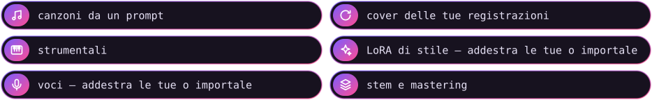

<p align="center">
  
</p>

<p align="center"><b>Canzoni intere con una partitura modificabile, fatte con YuE2 sulla tua GPU.</b></p>

<p align="center">
  <br>
  <a href="https://yeufonic.com/examples/"></a>
</p>

<p align="center">
  <a href="https://github.com/yeufonic/yeufonic/releases/latest"></a>
  <a href="https://yeufonic.com/macos/"></a>
  <a href="#avvio-rapido-con-docker"></a>
  <a href="https://yeufonic.com"></a>
</p>

<p align="center">
  <a href="https://github.com/yeufonic/yeufonic/releases/latest"></a>
  <a href="https://github.com/yeufonic/yeufonic/releases"></a>
  <a href="https://github.com/yeufonic/yeufonic/stargazers"></a>
  <a href="https://github.com/yeufonic/yeufonic/commits/main"></a>
  <a href="LICENSE"></a>
</p>

<p align="center"><a href="README.md">English</a> · <a href="README.de.md">Deutsch</a> · <a href="README.es.md">Español</a> · <a href="README.fr.md">Français</a> · <b>Italiano</b> · <a href="README.nl.md">Nederlands</a> · <a href="README.pt.md">Português</a> · <a href="README.ru.md">Русский</a> · <a href="README.ja.md">日本語</a> · <a href="README.ko.md">한국어</a> · <a href="README.zh-CN.md">简体中文</a> · <a href="README.zh-TW.md">繁體中文</a></p>

---

> Questa pagina è tradotta automaticamente ed è più breve del [README in inglese](README.md), che contiene ogni dettaglio. La guida completa è in italiano nell’app (Aiuto) e qui: **[guida in italiano](app/static/guides/it-IT.md)**.

Un’interfaccia web per [YuE2](https://github.com/multimodal-art-projection/YuE), il modello musicale aperto. Scrivi una canzone da un prompt o fai la cover di una tua registrazione. Addestra una LoRA locale su una raccolta di brani. In entrambi i casi modifica la partitura, poi separa gli stem dal risultato.

## Cosa fa

- **Canzone da un prompt:** scrivi un piano di partitura da uno stile e un testo, modificalo e fallo renderizzare.
- **Scegli il motore:** ComfyUI con i nodi YuE2, oppure yue2.cpp (GGUF) per GPU più piccole.
- **Cover di una registrazione:** trascrivi la tua canzone, cambiane melodia e accordi, renderizza una nuova versione.
- **Strumentali:** costruisci la struttura sezione per sezione, o suona la partitura di una registrazione.
- **Registra una melodia:** cantala, canticchiala o suonala, e trasforma poche battute in una canzone intera.
- **Importazione MIDI** per cover e strumentali, con piano roll e suoni SF2.
- **LoRA di stile:** usa quelle pubblicate o, con il motore ComfyUI, addestra le tue da una cartella di brani.
- **Voci registrate:** addestra una voce dal tuo canto e fai cantare qualsiasi take con quella voce.
- **Testi e duetti:** scrivi un testo da una frase o ricavalo da una registrazione; righe per un uomo, una donna o entrambi.
- **Rack di mastering vintage e 3D Space:** EQ, compressore e limiter in tempo reale; spazialità in cuffia e 5.1.
- **Stem e DAW:** separa una take in tracce, o salvala come zip con audio, stem, MIDI e partitura.
- **Una libreria:** spazi, preferiti, note e file take che condividono una take con la sua registrazione.
- **Immagini per le canzoni** con modelli locali o un tuo LLM esterno, e un **server MCP** per agenti di IA.
- **Un pannello della take e un editor:** il pannello a sinistra mostra come è nata la take scelta, e una grande finestra, in tre colonne o a passi, è dove le take si creano e si modificano.
- **Quindici lingue:** l’app e la sua guida, tradotte automaticamente.
- **LoRA e canzoni di esempio** fatte con Yeufonic: **[esempi](https://yeufonic.com/examples/)**.

Tutto gira su un solo computer, in due parti: l’app e il motore. Niente cloud né account; un LLM esterno per i testi è facoltativo.

## Requisiti

- Si consiglia una GPU NVIDIA con almeno 12 GB di VRAM e 16 GB di RAM. Vale la pena provare una scheda da 8 GB; per schede più piccole c’è il modello INT8 o il motore yue2.cpp.
- Addestrare una LoRA in locale richiede in pratica 16 GB di VRAM e 32 GB di RAM (8 GB di VRAM con il modello INT8).
- Circa 30 GB di spazio libero su disco, di più man mano che la libreria cresce.
- Un Mac con Apple silicon funziona in via sperimentale, molto più lentamente: vedi **[yeufonic.com/macos](https://yeufonic.com/macos/)**.

## Su Windows, senza Docker

Un piccolo programma di installazione configura Yeufonic in modo nativo, senza Docker, senza WSL e senza diritti di amministratore. Scaricalo dall’**[ultima versione](https://github.com/yeufonic/yeufonic/releases/latest)** e avvialo: controlla il PC prima di scaricare circa 27 GB, soprattutto i modelli. Un programma di installazione più recente aggiorna un’installazione esistente. Windows 10 22H2 o Windows 11 (64 bit), scheda NVIDIA RTX serie 30 o successiva.

## Avvio rapido con Docker

Su Linux, o Windows con WSL2, con Docker e il NVIDIA Container Toolkit:

```sh
git clone https://github.com/yeufonic/yeufonic.git
cd yeufonic
sh scripts/fetch-models.sh          # circa 19 GB, crea anche le cartelle
docker compose up -d --build
```

Poi apri <http://localhost:8090>. Le opzioni (il modello più piccolo, yue2.cpp, i modelli per le immagini, le LoRA di stile) sono nel [README in inglese](README.md#quick-start).

## Altro

- **[La guida completa in italiano](app/static/guides/it-IT.md)**, anche nell’app, sotto Aiuto.
- **[Canzoni e LoRA di esempio](https://yeufonic.com/examples/)**, fatte con Yeufonic.
- Bug e suggerimenti: [GitHub Issues](https://github.com/yeufonic/yeufonic/issues) (meglio in inglese).

## Licenza

Yeufonic ha una licenza per uso personale e non commerciale: vedi [LICENSE](LICENSE). Modelli, LoRA e altri componenti hanno licenze proprie; il [README in inglese](README.md#credits) le elenca.
