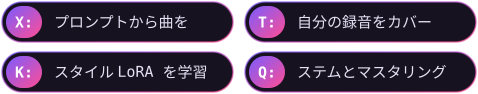

<p align="center">
  
</p>

<p align="center"><b>編集できる楽譜つきのフルソングを、自分の GPU で YuE2 が作ります。</b></p>

<p align="center">
  <br>
  <a href="https://yeufonic.com/examples/"></a>
</p>

<p align="center">
  <a href="https://github.com/yeufonic/yeufonic/releases/latest"></a>
  <a href="https://yeufonic.com/macos/"></a>
  <a href="#docker-でのクイックスタート"></a>
  <a href="https://yeufonic.com"></a>
</p>

<p align="center">
  <a href="https://github.com/yeufonic/yeufonic/releases/latest"></a>
  <a href="https://github.com/yeufonic/yeufonic/releases"></a>
  <a href="https://github.com/yeufonic/yeufonic/stargazers"></a>
  <a href="https://github.com/yeufonic/yeufonic/commits/main"></a>
  <a href="LICENSE"></a>
</p>

<p align="center"><a href="README.md">English</a> · <a href="README.de.md">Deutsch</a> · <a href="README.es.md">Español</a> · <a href="README.fr.md">Français</a> · <a href="README.it.md">Italiano</a> · <a href="README.nl.md">Nederlands</a> · <a href="README.pt.md">Português</a> · <a href="README.ru.md">Русский</a> · <b>日本語</b> · <a href="README.ko.md">한국어</a> · <a href="README.zh-CN.md">简体中文</a> · <a href="README.zh-TW.md">繁體中文</a></p>

---

> このページは機械翻訳で、すべての詳細を載せた[英語の README](README.md) より短くなっています。完全なガイドは日本語でアプリ内（ヘルプ）とここにあります: **[日本語のガイド](app/static/guides/ja-JP.md)**。

オープンな音楽モデル [YuE2](https://github.com/multimodal-art-projection/YuE) のための Web インターフェースです。プロンプトから曲を書いたり、自分の録音をカバーしたりできます。音楽のコレクションからローカルで LoRA を学習できます。どちらでも楽譜を編集でき、仕上がった曲からステムを取り出せます。

## できること

- **プロンプトから曲を:** スタイルと歌詞から楽譜プランを書き、編集してレンダリングします。
- **エンジンを選べる:** YuE2 ノード付きの ComfyUI か、小さな GPU 向けの yue2.cpp（GGUF）。
- **録音をカバー:** 自分の曲を採譜し、メロディとコードを変えて新しいバージョンをレンダリングします。
- **インスト:** セクションごとに構成を組むか、録音の楽譜を演奏します。
- **メロディを録音:** 歌う・ハミングする・楽器で弾くだけで、数小節を1曲に広げます。
- **MIDI の読み込み**（カバーとインスト用）。ピアノロールと SF2 音源つき。
- **スタイル LoRA:** 公開されたものを使うか、ComfyUI エンジンなら曲のフォルダから自分で学習できます。
- **録音した声:** 自分の歌声から声を学習し、どのテイクもその声で歌わせます。
- **歌詞とデュエット:** 一文から歌詞を下書きしたり、録音から聞き取ったり。男性・女性・両方の行を指定できます。
- **ヴィンテージ・マスタリングラックと 3D Space:** EQ、コンプレッサー、リミッターをリアルタイムで。ヘッドホンの立体音響と 5.1 も。
- **ステムと DAW:** テイクをトラックに分けるか、音声・ステム・MIDI・楽譜をまとめた zip で保存します。
- **ライブラリ:** スペース、スター、メモ、録音ごと共有できるテイクファイル。
- **曲の画像**をローカルモデルか自分の外部 LLM で作成。AI エージェント向けの **MCP サーバー**も。
- **テイクパネルとエディター:** 左のパネルに選んだテイクの作り方が表示され、3 列またはステップ表示の大きなウィンドウでテイクを作り、変えます。
- **15 の言語:** アプリとガイドを機械翻訳で。
- Yeufonic で作った**サンプルの LoRA と曲**: **[サンプル](https://yeufonic.com/examples/)**。

すべてが1台のマシンで、アプリとエンジンの2つに分かれて動きます。クラウドもアカウントも不要で、歌詞用の外部 LLM は任意です。

## 必要なもの

- VRAM 12 GB 以上の NVIDIA GPU と 16 GB のメモリを推奨します。8 GB のカードも試す価値があり、さらに小さいカードには INT8 モデルか yue2.cpp エンジンがあります。
- ローカルで LoRA を学習するには、実質 16 GB の VRAM と 32 GB のメモリが必要です（INT8 モデルなら VRAM 8 GB）。
- 約 30 GB の空きディスク。ライブラリが増えるとさらに必要です。
- Apple シリコンの Mac は試験的に動きますが、かなり遅くなります: **[yeufonic.com/macos](https://yeufonic.com/macos/)** を参照。

## Windows で、Docker なしで

小さなインストーラーが Docker も WSL も管理者権限もなしに Yeufonic をネイティブに設定します。**[最新リリース](https://github.com/yeufonic/yeufonic/releases/latest)** からダウンロードして実行してください。約 27 GB（大半はモデル）をダウンロードする前に PC を確認します。新しいインストーラーは既存のインストールを更新します。Windows 10 22H2 または Windows 11（64 ビット）、NVIDIA RTX 30 シリーズ以降。

## Docker でのクイックスタート

Linux、または WSL2 の Windows で、Docker と NVIDIA Container Toolkit を使います:

```sh
git clone https://github.com/yeufonic/yeufonic.git
cd yeufonic
sh scripts/fetch-models.sh          # 約 19 GB、フォルダも作成
docker compose up -d --build
```

その後 <http://localhost:8090> を開きます。オプション（小さいモデル、yue2.cpp、画像モデル、スタイル LoRA）は[英語の README](README.md#quick-start) にあります。

## さらに

- **[日本語の完全なガイド](app/static/guides/ja-JP.md)**。アプリのヘルプからも読めます。
- Yeufonic で作った **[サンプル曲と LoRA](https://yeufonic.com/examples/)**。
- 不具合や要望: [GitHub Issues](https://github.com/yeufonic/yeufonic/issues)（英語だと助かります）。

## ライセンス

Yeufonic は個人・非商用利用のライセンスです: [LICENSE](LICENSE) を参照してください。モデル、LoRA、その他の部品にはそれぞれのライセンスがあり、[英語の README](README.md#credits) に記載しています。
