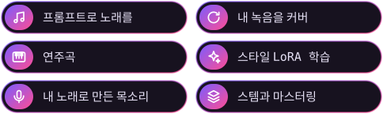

<p align="center">
  
</p>

<p align="center"><b>편집할 수 있는 악보와 함께, 내 GPU에서 YuE2로 만드는 완성곡.</b></p>

<p align="center">
  <br>
  <a href="https://yeufonic.com/examples/"></a>
</p>

<p align="center">
  <a href="https://github.com/yeufonic/yeufonic/releases/latest"></a>
  <a href="https://yeufonic.com/macos/"></a>
  <a href="#docker로-빠르게-시작하기"></a>
  <a href="https://yeufonic.com"></a>
</p>

<p align="center">
  <a href="https://github.com/yeufonic/yeufonic/releases/latest"></a>
  <a href="https://github.com/yeufonic/yeufonic/releases"></a>
  <a href="https://github.com/yeufonic/yeufonic/stargazers"></a>
  <a href="https://github.com/yeufonic/yeufonic/commits/main"></a>
  <a href="LICENSE"></a>
</p>

<p align="center"><a href="README.md">English</a> · <a href="README.de.md">Deutsch</a> · <a href="README.es.md">Español</a> · <a href="README.fr.md">Français</a> · <a href="README.it.md">Italiano</a> · <a href="README.nl.md">Nederlands</a> · <a href="README.pt.md">Português</a> · <a href="README.ru.md">Русский</a> · <a href="README.ja.md">日本語</a> · <b>한국어</b> · <a href="README.zh-CN.md">简体中文</a> · <a href="README.zh-TW.md">繁體中文</a></p>

---

> 이 페이지는 기계 번역이며, 모든 세부 사항이 담긴 [영어 README](README.md)보다 짧습니다. 전체 안내서는 앱(도움말)과 여기에서 한국어로 볼 수 있습니다: **[한국어 안내서](app/static/guides/ko-KR.md)**.

열린 음악 모델 [YuE2](https://github.com/multimodal-art-projection/YuE)를 위한 웹 인터페이스입니다. 프롬프트로 노래를 쓰거나 내 녹음을 커버하세요. 음악 모음으로 로컬 LoRA를 학습하세요. 어느 쪽이든 악보를 편집하고, 결과에서 스템을 뽑아낼 수 있습니다.

## 할 수 있는 일

- **프롬프트로 노래:** 스타일과 가사로 악보 계획을 쓰고, 편집하고, 렌더링합니다.
- **엔진 선택:** YuE2 노드가 있는 ComfyUI, 또는 작은 GPU를 위한 yue2.cpp(GGUF).
- **녹음 커버:** 내 노래를 채보하고 멜로디와 코드를 바꿔 새 버전을 렌더링합니다.
- **연주곡:** 섹션별로 구조를 짜거나 녹음의 악보를 연주합니다.
- **멜로디 녹음:** 노래하거나 흥얼거리거나 악기로 연주해, 몇 마디를 한 곡으로 늘립니다.
- 커버와 연주곡을 위한 **MIDI 가져오기**, 피아노 롤과 SF2 음원 포함.
- **스타일 LoRA:** 공개된 것을 쓰거나, ComfyUI 엔진으로 노래 폴더에서 직접 학습합니다.
- **녹음한 목소리:** 내 노래로 목소리를 학습하고 어떤 테이크든 그 목소리로 부르게 합니다.
- **가사와 듀엣:** 한 문장으로 가사 초안을 쓰거나 녹음에서 받아 적고, 남성·여성·둘 다의 줄을 지정합니다.
- **빈티지 마스터링 랙과 3D Space:** EQ, 컴프레서, 리미터를 실시간으로. 헤드폰 공간 음향과 5.1도.
- **스템과 DAW:** 테이크를 트랙으로 나누거나 오디오·스템·MIDI·악보를 담은 zip으로 저장합니다.
- **라이브러리:** 스페이스, 별표, 메모, 그리고 녹음과 함께 공유하는 테이크 파일.
- **노래 이미지**를 로컬 모델이나 내 외부 LLM으로, 그리고 AI 에이전트를 위한 **MCP 서버**.
- **테이크 패널과 편집기:** 왼쪽 패널은 고른 테이크가 어떻게 만들어졌는지 보여 주고, 세 열이나 단계로 보는 큰 창에서 테이크를 만들고 바꿉니다.
- **15개 언어:** 앱과 안내서를 기계 번역으로.
- Yeufonic으로 만든 **예제 LoRA와 노래**: **[예제](https://yeufonic.com/examples/)**.

모든 것이 한 컴퓨터에서 앱과 엔진, 두 부분으로 돌아갑니다. 클라우드도 계정도 없으며, 가사용 외부 LLM은 선택입니다.

## 요구 사항

- VRAM 12GB 이상의 NVIDIA GPU와 16GB 메모리를 권장합니다. 8GB 카드도 시도해 볼 만하며, 더 작은 카드에는 INT8 모델이나 yue2.cpp 엔진이 있습니다.
- 로컬에서 LoRA를 학습하려면 사실상 VRAM 16GB와 메모리 32GB가 필요합니다(INT8 모델은 VRAM 8GB).
- 약 30GB의 여유 디스크 공간, 라이브러리가 커질수록 더 필요합니다.
- Apple 실리콘 Mac에서도 LoRA 학습을 포함해 모두 동작하지만 NVIDIA 그래픽 카드보다 훨씬 느립니다: **[yeufonic.com/macos](https://yeufonic.com/macos/)** 참고.
- **네이티브 Linux:** Docker 없이 Yeufonic을 설치하세요. **[네이티브 Linux](app/static/guides/ko-KR.md#native-linux)** 참고.
- **Docker (Linux 및 Windows WSL2):** Docker로 Yeufonic을 설치하고 실행하세요. **[Docker로 빠르게 시작하기](#docker로-빠르게-시작하기)**와 [영어 README](README.md#quick-start) 참고.

## Windows에서, Docker 없이

작은 설치 프로그램이 Docker, WSL, 관리자 권한 없이 Yeufonic을 기본 방식으로 설치합니다. **[최신 릴리스](https://github.com/yeufonic/yeufonic/releases/latest)**에서 내려받아 실행하세요. 약 27GB(대부분 모델)를 내려받기 전에 PC를 확인합니다. 더 새로운 설치 프로그램은 기존 설치를 업데이트합니다. Windows 10 22H2 또는 Windows 11(64비트), NVIDIA RTX 30 시리즈 이상.

## Docker로 빠르게 시작하기

Linux, 또는 WSL2가 있는 Windows에서 Docker와 NVIDIA Container Toolkit으로:

```sh
git clone https://github.com/yeufonic/yeufonic.git
cd yeufonic
sh scripts/fetch-models.sh          # 약 19GB, 폴더도 만듭니다
docker compose up -d --build
```

그런 다음 <http://localhost:8090>을 엽니다. 옵션(작은 모델, yue2.cpp, FIBO 2.0을 포함한 이미지 모델, 스타일 LoRA)은 [영어 README](README.md#quick-start)에 있습니다.

## Linux에서, Docker 없이

NVIDIA GPU가 장착된 Linux 컴퓨터에서는 Docker 없이 네이티브로 실행할 수도 있습니다(ComfyUI 또는 yue2.cpp): **[linux/README.md](linux/README.md)**를 참고하세요.

## 더 보기

- **[한국어 전체 안내서](app/static/guides/ko-KR.md)**, 앱의 도움말에서도 볼 수 있습니다.
- Yeufonic으로 만든 **[예제 노래와 LoRA](https://yeufonic.com/examples/)**.
- 버그와 제안: [GitHub Issues](https://github.com/yeufonic/yeufonic/issues)(영어면 더 좋습니다).

## 라이선스

Yeufonic은 개인·비상업 용도 라이선스입니다: [LICENSE](LICENSE)를 보세요. 모델, LoRA, 기타 구성 요소에는 각자의 라이선스가 있으며 [영어 README](README.md#credits)에 나와 있습니다.
