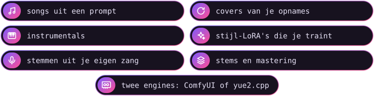

<p align="center">
  
</p>

<p align="center"><b>Complete songs met een bewerkbare partituur, gemaakt met YuE2 op je eigen GPU.</b></p>

<p align="center">
  <br>
  <a href="https://yeufonic.com/examples/"></a>
</p>

<p align="center">
  <a href="https://github.com/yeufonic/yeufonic/releases/latest"></a>
  <a href="https://yeufonic.com/macos/"></a>
  <a href="#snel-starten-met-docker"></a>
  <a href="https://yeufonic.com"></a>
</p>

<p align="center">
  <a href="https://github.com/yeufonic/yeufonic/releases/latest"></a>
  <a href="https://github.com/yeufonic/yeufonic/releases"></a>
  <a href="https://github.com/yeufonic/yeufonic/stargazers"></a>
  <a href="https://github.com/yeufonic/yeufonic/commits/main"></a>
  <a href="LICENSE"></a>
</p>

<p align="center"><a href="README.md">English</a> · <a href="README.de.md">Deutsch</a> · <a href="README.es.md">Español</a> · <a href="README.fr.md">Français</a> · <a href="README.it.md">Italiano</a> · <b>Nederlands</b> · <a href="README.pt.md">Português</a> · <a href="README.ru.md">Русский</a> · <a href="README.ja.md">日本語</a> · <a href="README.ko.md">한국어</a> · <a href="README.zh-CN.md">简体中文</a> · <a href="README.zh-TW.md">繁體中文</a></p>

---

> Deze pagina is automatisch vertaald en korter dan de [Engelse README](README.md), die elk detail bevat. De volledige handleiding staat in het Nederlands in de app (Help) en hier: **[handleiding in het Nederlands](app/static/guides/nl-NL.md)**.

Een webinterface voor [YuE2](https://github.com/multimodal-art-projection/YuE), het open muziekmodel. Schrijf een song vanuit een prompt, of maak een cover van je eigen opname. Train een lokale LoRA op een verzameling muziek. Bewerk in beide gevallen de partituur en haal daarna de stems uit het resultaat.

## Wat het doet

- **Song uit een prompt:** schrijf een partituurplan vanuit een stijl en songtekst, bewerk het en render het.
- **Kies je engine:** ComfyUI met de YuE2-nodes, of yue2.cpp (GGUF) voor kleinere GPU's.
- **Een opname coveren:** transcribeer je song, verander melodie en akkoorden, render een nieuwe versie.
- **Instrumentals:** bouw de structuur sectie voor sectie op, of speel de partituur van een opname.
- **Een melodie opnemen:** zing, neurie of speel hem, en maak van een paar maten een hele song.
- **MIDI-import** voor covers en instrumentals, met pianorol en SF2-klanken.
- **Stijl-LoRA's:** gebruik gepubliceerde, of train met de ComfyUI-engine je eigen uit een map met songs.
- **Opgenomen stemmen:** train een stem op je eigen zang en laat elke take ermee zingen.
- **Teksten en duetten:** schrijf een tekst vanuit één zin of haal hem uit een opname; regels voor een man, een vrouw of beiden.
- **Vintage masteringrack en 3D Space:** EQ, compressor en limiter in realtime; ruimtelijk geluid op koptelefoon en 5.1.
- **Stems en DAW:** splits een take in sporen, of bewaar hem als zip met audio, stems, MIDI en partituur.
- **Een bibliotheek:** spaces, sterren, notities en takebestanden die een take met zijn opname delen.
- **Afbeeldingen bij songs** met lokale modellen of je eigen externe LLM, en een **MCP-server** voor AI-agents.
- **Een takepaneel en een editor:** het linkerpaneel toont hoe de gekozen take gemaakt is, en een groot venster, in drie kolommen of in stappen, is waar takes gemaakt en veranderd worden.
- **Vijftien talen:** de app en de handleiding, automatisch vertaald.
- **Voorbeeld-LoRA's en -songs**, gemaakt met Yeufonic: **[voorbeelden](https://yeufonic.com/examples/)**.

Alles draait op één computer, in twee delen: de app en de engine. Geen cloud en geen accounts; een externe LLM voor teksten is optioneel.

## Vereisten

- Een NVIDIA-GPU met 12 GB VRAM of meer wordt aanbevolen, met 16 GB RAM. Een kaart met 8 GB is het proberen waard; voor kleinere kaarten is er het INT8-model of de engine yue2.cpp.
- Lokaal een LoRA trainen vraagt in de praktijk 16 GB VRAM en 32 GB RAM (8 GB VRAM met het INT8-model).
- Ongeveer 30 GB vrije schijfruimte, meer naarmate de bibliotheek groeit.
- Een Mac met Apple silicon kan alles, ook LoRA's trainen, maar veel trager dan een NVIDIA-kaart: zie **[yeufonic.com/macos](https://yeufonic.com/macos/)**.

## Op Windows, zonder Docker

Een klein installatieprogramma zet Yeufonic native op, zonder Docker, zonder WSL en zonder beheerdersrechten. Download het bij de **[nieuwste versie](https://github.com/yeufonic/yeufonic/releases/latest)** en start het: het controleert je pc voordat het ongeveer 27 GB downloadt, vooral de modellen. Een nieuwer installatieprogramma werkt een bestaande installatie bij. Windows 10 22H2 of Windows 11 (64-bit), NVIDIA-kaart uit de RTX 30-serie of nieuwer.

## Snel starten met Docker

Op Linux, of Windows met WSL2, met Docker en de NVIDIA Container Toolkit:

```sh
git clone https://github.com/yeufonic/yeufonic.git
cd yeufonic
sh scripts/fetch-models.sh          # ongeveer 19 GB, maakt ook de mappen aan
docker compose up -d --build
```

Open daarna <http://localhost:8090>. De opties (het kleinere model, yue2.cpp, beeldmodellen, stijl-LoRA's) staan in de [Engelse README](README.md#quick-start).

## Meer

- **[De volledige handleiding in het Nederlands](app/static/guides/nl-NL.md)**, ook in de app onder Help.
- **[Voorbeeldsongs en LoRA's](https://yeufonic.com/examples/)**, gemaakt met Yeufonic.
- Fouten en wensen: [GitHub Issues](https://github.com/yeufonic/yeufonic/issues) (liefst in het Engels).

## Licentie

Yeufonic valt onder een licentie voor persoonlijk, niet-commercieel gebruik: zie [LICENSE](LICENSE). Modellen, LoRA's en andere onderdelen hebben hun eigen licenties; de [Engelse README](README.md#credits) noemt ze.
