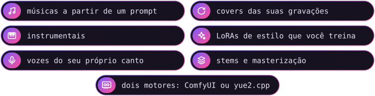

<p align="center">
  
</p>

<p align="center"><b>Músicas inteiras com uma partitura editável, feitas com o YuE2 na sua própria GPU.</b></p>

<p align="center">
  <br>
  <a href="https://yeufonic.com/examples/"></a>
</p>

<p align="center">
  <a href="https://github.com/yeufonic/yeufonic/releases/latest"></a>
  <a href="https://yeufonic.com/macos/"></a>
  <a href="#início-rápido-com-docker"></a>
  <a href="https://yeufonic.com"></a>
</p>

<p align="center">
  <a href="https://github.com/yeufonic/yeufonic/releases/latest"></a>
  <a href="https://github.com/yeufonic/yeufonic/releases"></a>
  <a href="https://github.com/yeufonic/yeufonic/stargazers"></a>
  <a href="https://github.com/yeufonic/yeufonic/commits/main"></a>
  <a href="LICENSE"></a>
</p>

<p align="center"><a href="README.md">English</a> · <a href="README.de.md">Deutsch</a> · <a href="README.es.md">Español</a> · <a href="README.fr.md">Français</a> · <a href="README.it.md">Italiano</a> · <a href="README.nl.md">Nederlands</a> · <b>Português</b> · <a href="README.ru.md">Русский</a> · <a href="README.ja.md">日本語</a> · <a href="README.ko.md">한국어</a> · <a href="README.zh-CN.md">简体中文</a> · <a href="README.zh-TW.md">繁體中文</a></p>

---

> Esta página foi traduzida automaticamente e é mais curta que o [README em inglês](README.md), que tem todos os detalhes. O guia completo está em português no aplicativo (Ajuda) e aqui: **[guia em português](app/static/guides/pt-BR.md)** ([Portugal](app/static/guides/pt-PT.md)).

Uma interface web para o [YuE2](https://github.com/multimodal-art-projection/YuE), o modelo musical aberto. Escreva uma música a partir de um prompt, ou faça um cover da sua própria gravação. Treine uma LoRA local num conjunto de músicas. Nos dois casos, edite a partitura e depois separe os stems do resultado.

## O que ele faz

- **Música a partir de um prompt:** escreva um plano de partitura a partir de um estilo e de uma letra, edite e renderize.
- **Escolha o motor:** ComfyUI com os nós do YuE2, ou yue2.cpp (GGUF) para GPUs menores.
- **Cover de uma gravação:** transcreva a sua música, mude a melodia e os acordes, renderize uma versão nova.
- **Instrumentais:** monte a estrutura seção por seção, ou toque a partitura de uma gravação.
- **Grave uma melodia:** cante, cantarole ou toque, e transforme alguns compassos numa música inteira.
- **Importação MIDI** para covers e instrumentais, com piano roll e sons SF2.
- **LoRAs de estilo:** use as publicadas ou, com o motor ComfyUI, treine as suas a partir de uma pasta de músicas.
- **Vozes gravadas:** treine uma voz com o seu próprio canto e faça qualquer take ser cantado com ela.
- **Letras e duetos:** escreva uma letra a partir de uma frase ou tire-a de uma gravação; versos para um homem, uma mulher ou ambos.
- **Rack de masterização vintage e 3D Space:** EQ, compressor e limitador em tempo real; som espacial em fones e 5.1.
- **Stems e DAW:** separe um take em faixas, ou salve-o como zip com áudio, stems, MIDI e partitura.
- **Uma biblioteca:** espaços, favoritos, notas e arquivos de take que compartilham um take com a gravação.
- **Imagens para músicas** com modelos locais ou o seu próprio LLM externo, e um **servidor MCP** para agentes de IA.
- **Um painel de take e um editor:** o painel à esquerda mostra como o take escolhido foi feito, e uma janela grande, em três colunas ou em passos, é onde os takes são feitos e mudados.
- **Quinze idiomas:** o aplicativo e o guia, com tradução automática.
- **LoRAs e músicas de exemplo** feitas com o Yeufonic: **[exemplos](https://yeufonic.com/examples/)**.

Tudo roda num único computador, em duas partes: o aplicativo e o motor. Sem nuvem e sem contas; um LLM externo para letras é opcional.

## Requisitos

- Recomenda-se uma GPU NVIDIA com 12 GB de VRAM ou mais, e 16 GB de RAM. Vale a pena tentar uma placa de 8 GB; para placas menores há o modelo INT8 ou o motor yue2.cpp.
- Treinar uma LoRA localmente exige, na prática, 16 GB de VRAM e 32 GB de RAM (8 GB de VRAM com o modelo INT8).
- Cerca de 30 GB livres em disco, mais à medida que a biblioteca cresce.
- Um Mac com Apple silicon faz tudo, incluindo treinar LoRAs, mas bem mais devagar que uma placa NVIDIA: veja **[yeufonic.com/macos](https://yeufonic.com/macos/)**.
- **Linux nativo:** Instale o Yeufonic sem Docker. Veja **[Linux nativo](app/static/guides/pt-BR.md#native-linux)** ([Portugal](app/static/guides/pt-PT.md#native-linux)).
- **Docker (Linux e Windows WSL2):** Instale e execute o Yeufonic com Docker. Veja **[Início rápido com Docker](#início-rápido-com-docker)** e o [README em inglês](README.md#quick-start).

## No Windows, sem Docker

Um pequeno instalador configura o Yeufonic de forma nativa, sem Docker, sem WSL e sem permissões de administrador. Baixe-o na **[versão mais recente](https://github.com/yeufonic/yeufonic/releases/latest)** e execute: ele verifica o seu PC antes de baixar cerca de 27 GB, quase tudo modelos. Um instalador mais novo atualiza uma instalação existente. Windows 10 22H2 ou Windows 11 (64 bits), placa NVIDIA RTX série 30 ou mais nova.

## Início rápido com Docker

No Linux, ou no Windows com WSL2, com Docker e o NVIDIA Container Toolkit:

```sh
git clone https://github.com/yeufonic/yeufonic.git
cd yeufonic
sh scripts/fetch-models.sh          # cerca de 19 GB, e cria as pastas
docker compose up -d --build
```

Depois abra <http://localhost:8090>. As opções (o modelo menor, yue2.cpp, modelos de imagem incluindo FIBO 2.0, LoRAs de estilo) estão no [README em inglês](README.md#quick-start).

## No Linux, sem Docker

Em uma máquina Linux com GPU NVIDIA, o Yeufonic também roda de forma nativa sem Docker (com ComfyUI ou yue2.cpp): veja **[linux/README.md](linux/README.md)**.

## Mais

- **[O guia completo em português](app/static/guides/pt-BR.md)**, também no aplicativo, em Ajuda.
- **[Músicas e LoRAs de exemplo](https://yeufonic.com/examples/)**, feitas com o Yeufonic.
- Erros e sugestões: [GitHub Issues](https://github.com/yeufonic/yeufonic/issues) (de preferência em inglês).

## Licença

O Yeufonic tem uma licença para uso pessoal e não comercial: veja [LICENSE](LICENSE). Modelos, LoRAs e outros componentes têm licenças próprias; o [README em inglês](README.md#credits) as lista.
