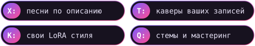

<p align="center">
  
</p>

<p align="center"><b>Целые песни с редактируемой партитурой, созданные YuE2 на вашей видеокарте.</b></p>

<p align="center">
  
</p>

<p align="center">
  <a href="https://github.com/yeufonic/yeufonic/releases/latest"></a>
  <a href="https://yeufonic.com/macos/"></a>
  <a href="#быстрый-старт-с-docker"></a>
  <a href="https://yeufonic.com"></a>
</p>

<p align="center">
  <a href="https://github.com/yeufonic/yeufonic/releases/latest"></a>
  <a href="https://github.com/yeufonic/yeufonic/releases"></a>
  <a href="https://github.com/yeufonic/yeufonic/stargazers"></a>
  <a href="https://github.com/yeufonic/yeufonic/commits/main"></a>
  <a href="LICENSE"></a>
</p>

<p align="center"><a href="README.md">English</a> · <a href="README.de.md">Deutsch</a> · <a href="README.es.md">Español</a> · <a href="README.fr.md">Français</a> · <a href="README.it.md">Italiano</a> · <a href="README.nl.md">Nederlands</a> · <a href="README.pt.md">Português</a> · <b>Русский</b> · <a href="README.ja.md">日本語</a> · <a href="README.ko.md">한국어</a> · <a href="README.zh-CN.md">简体中文</a> · <a href="README.zh-TW.md">繁體中文</a></p>

---

> Эта страница переведена автоматически и короче [README на английском](README.md), где есть все подробности. Полное руководство на русском есть в приложении (Справка) и здесь: **[руководство на русском](app/static/guides/ru-RU.md)**.

Веб-интерфейс для [YuE2](https://github.com/multimodal-art-projection/YuE), открытой музыкальной модели. Напишите песню по описанию или сделайте кавер собственной записи. Обучите локальную LoRA на подборке музыки. В обоих случаях редактируйте партитуру, а затем разделите результат на стемы.

## Что он умеет

- **Песня по описанию:** напишите план партитуры по стилю и тексту, отредактируйте и отрендерите.
- **Выбор движка:** ComfyUI с узлами YuE2 или yue2.cpp (GGUF) для видеокарт поменьше.
- **Кавер записи:** транскрибируйте свою песню, измените мелодию и аккорды, отрендерите новую версию.
- **Инструменталы:** соберите структуру по частям или сыграйте партитуру записи.
- **Запись мелодии:** спойте, напойте или сыграйте её и превратите несколько тактов в целую песню.
- **LoRA стиля:** используйте опубликованные или, с движком ComfyUI, обучите свои на папке с песнями.
- **Записанные голоса:** обучите голос на своём пении и пусть любой дубль поётся им.
- **Тексты и дуэты:** набросайте текст по одной фразе или распознайте его из записи; строки для мужчины, женщины или обоих.
- **Винтажная мастеринговая стойка и 3D Space:** эквалайзер, компрессор и лимитер в реальном времени; объёмный звук в наушниках и 5.1.
- **Стемы и DAW:** разделите дубль на дорожки или сохраните его zip-архивом с аудио, стемами, MIDI и партитурой.
- **Библиотека:** пространства, звёзды, заметки и файлы дублей, которыми можно поделиться вместе с записью.
- **Обложки к песням** с локальными моделями или своей внешней LLM и **MCP-сервер** для ИИ-агентов.
- **Пятнадцать языков:** приложение и руководство в машинном переводе.

Всё работает на одном компьютере, в двух частях: приложение и движок. Без облака и учётных записей; внешняя LLM для текстов необязательна.

## Требования

- Рекомендуется видеокарта NVIDIA с 12 ГБ видеопамяти или больше и 16 ГБ ОЗУ. Карту на 8 ГБ стоит попробовать; для карт поменьше есть модель INT8 или движок yue2.cpp.
- Для локального обучения LoRA на практике нужны 16 ГБ видеопамяти и 32 ГБ ОЗУ (8 ГБ видеопамяти с моделью INT8).
- Около 30 ГБ свободного места на диске, больше по мере роста библиотеки.
- Mac на Apple silicon работает в экспериментальном режиме и заметно медленнее: см. **[yeufonic.com/macos](https://yeufonic.com/macos/)**.

## В Windows, без Docker

Небольшой установщик настраивает Yeufonic напрямую в Windows, без Docker, без WSL и без прав администратора. Скачайте его из **[последней версии](https://github.com/yeufonic/yeufonic/releases/latest)** и запустите: он проверит компьютер, прежде чем скачать около 27 ГБ, в основном модели. Более новый установщик обновляет существующую установку. Windows 10 22H2 или Windows 11 (64 бит), видеокарта NVIDIA RTX 30-й серии или новее.

## Быстрый старт с Docker

В Linux или в Windows с WSL2, с Docker и NVIDIA Container Toolkit:

```sh
git clone https://github.com/yeufonic/yeufonic.git
cd yeufonic
sh scripts/fetch-models.sh          # около 19 ГБ, заодно создаёт папки
docker compose up -d --build
```

Затем откройте <http://localhost:8090>. Параметры (модель поменьше, yue2.cpp, модели для обложек, LoRA стиля) описаны в [README на английском](README.md#quick-start).

## Ещё

- **[Полное руководство на русском](app/static/guides/ru-RU.md)**, а также в приложении, в разделе «Справка».
- **[Примеры песен и LoRA](https://yeufonic.com/examples/)**, сделанные в Yeufonic.
- Ошибки и пожелания: [GitHub Issues](https://github.com/yeufonic/yeufonic/issues) (лучше на английском).

## Лицензия

Yeufonic распространяется по лицензии для личного некоммерческого использования: см. [LICENSE](LICENSE). У моделей, LoRA и других компонентов свои лицензии; они перечислены в [README на английском](README.md#credits).
