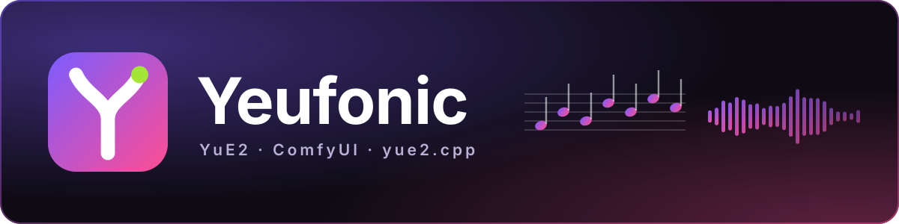

<p align="center">
  
</p>

<p align="center"><b>帶可編輯樂譜的完整歌曲，由 YuE2 在你自己的 GPU 上生成。</b></p>

<p align="center">
  
</p>

<p align="center">
  <a href="https://github.com/yeufonic/yeufonic/releases/latest"></a>
  <a href="https://yeufonic.com/macos/"></a>
  <a href="#用-docker-快速開始"></a>
  <a href="https://yeufonic.com"></a>
</p>

<p align="center">
  <a href="https://github.com/yeufonic/yeufonic/releases/latest"></a>
  <a href="https://github.com/yeufonic/yeufonic/releases"></a>
  <a href="https://github.com/yeufonic/yeufonic/stargazers"></a>
  <a href="https://github.com/yeufonic/yeufonic/commits/main"></a>
  <a href="LICENSE"></a>
</p>

<p align="center"><a href="README.md">English</a> · <a href="README.de.md">Deutsch</a> · <a href="README.es.md">Español</a> · <a href="README.fr.md">Français</a> · <a href="README.it.md">Italiano</a> · <a href="README.nl.md">Nederlands</a> · <a href="README.pt.md">Português</a> · <a href="README.ru.md">Русский</a> · <a href="README.ja.md">日本語</a> · <a href="README.ko.md">한국어</a> · <a href="README.zh-CN.md">简体中文</a> · <b>繁體中文</b></p>

---

> 本頁為機器翻譯，比包含全部細節的[英文 README](README.md) 更簡短。完整的中文指南在應用程式內（說明）以及這裡：**[繁體中文指南](app/static/guides/zh-TW.md)**。

一個為開放音樂模型 [YuE2](https://github.com/multimodal-art-projection/YuE) 打造的網頁介面。用提示詞寫歌，或翻唱你自己的錄音。用一組音樂在本機訓練 LoRA。兩種方式都能編輯樂譜，然後從成品中分離出分軌。

## 它能做什麼

- **從提示詞寫歌：**根據風格和歌詞寫出樂譜方案，編輯後算繪。
- **選擇引擎：**帶 YuE2 節點的 ComfyUI，或適合小顯示卡的 yue2.cpp（GGUF）。
- **翻唱錄音：**把你的歌轉成樂譜，修改旋律與和弦，算繪出新版本。
- **純音樂：**逐段搭建結構，或演奏一段錄音的樂譜。
- **錄一段旋律：**唱、哼或用樂器彈，把幾個小節擴展成整首歌。
- **風格 LoRA：**使用已發布的，或用 ComfyUI 引擎從一個歌曲資料夾訓練你自己的。
- **錄製的嗓音：**用你自己的歌聲訓練嗓音，讓任何版本都用它來唱。
- **歌詞與對唱：**一句話起草歌詞，或從錄音中聽寫；為男聲、女聲或合唱指定歌詞行。
- **復古母帶機架與 3D Space：**即時 EQ、壓縮器和限制器；耳機空間聲與 5.1。
- **分軌與 DAW：**把版本拆成音軌，或存為包含音訊、分軌、MIDI 和樂譜的 zip。
- **資料庫：**空間、星號、備註，以及可連同錄音一起分享的版本檔案。
- **歌曲配圖**可用本機模型或你自己的外部 LLM，還有面向 AI 代理的 **MCP 伺服器**。
- **十五種語言：**應用程式和指南均為機器翻譯。

一切都在一台電腦上執行，分為兩部分：應用程式和引擎。不用雲端，也不用帳號；寫歌詞的外部 LLM 是選用的。

## 需求

- 建議使用 12 GB 顯示記憶體以上的 NVIDIA 顯示卡和 16 GB 記憶體。8 GB 顯示卡也值得一試；更小的顯示卡可用 INT8 模型或 yue2.cpp 引擎。
- 在本機訓練 LoRA 實際需要 16 GB 顯示記憶體和 32 GB 記憶體（INT8 模型只需 8 GB 顯示記憶體）。
- 約 30 GB 可用磁碟空間，資料庫變大後需要更多。
- Apple 晶片的 Mac 可試驗性執行，但慢得多：見 **[yeufonic.com/macos](https://yeufonic.com/macos/)**。

## 在 Windows 上，無需 Docker

一個小安裝程式可在 Windows 上原生安裝 Yeufonic，無需 Docker、WSL 或系統管理員權限。從**[最新版本](https://github.com/yeufonic/yeufonic/releases/latest)**下載並執行：它會先檢查電腦，再下載約 27 GB（大部分是模型）。新版安裝程式會更新既有的安裝。需要 Windows 10 22H2 或 Windows 11（64 位元），以及 NVIDIA RTX 30 系列或更新的顯示卡。

## 用 Docker 快速開始

在 Linux，或裝有 WSL2 的 Windows 上，搭配 Docker 和 NVIDIA Container Toolkit：

```sh
git clone https://github.com/yeufonic/yeufonic.git
cd yeufonic
sh scripts/fetch-models.sh          # 約 19 GB，同時建立資料夾
docker compose up -d --build
```

然後開啟 <http://localhost:8090>。各種選項（較小的模型、yue2.cpp、影像模型、風格 LoRA）見[英文 README](README.md#quick-start)。

## 更多

- **[完整的繁體中文指南](app/static/guides/zh-TW.md)**，也可在應用程式的說明中閱讀。
- 用 Yeufonic 製作的**[範例歌曲和 LoRA](https://yeufonic.com/examples/)**。
- 問題與建議：[GitHub Issues](https://github.com/yeufonic/yeufonic/issues)（最好用英文）。

## 授權

Yeufonic 採用個人非商業使用授權：見 [LICENSE](LICENSE)。模型、LoRA 和其他元件各有其授權，[英文 README](README.md#credits) 中有列出。
